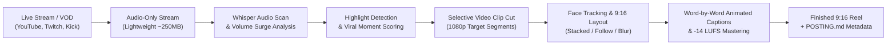

<div align="center">

# 🎬 Stack Cut Pro

**Next-Gen AI Stream-to-Reels Highlight Clipper & 9:16 Vertical Video Studio**

[](https://opensource.org/licenses/MIT)
[](https://www.python.org/downloads/)
[]()
[](https://github.com/psf/black)
[]()
[](https://github.com/yk-ayush-07)

<p align="center">
  Turn long multi-hour live streams into viral, high-retention 9:16 vertical shorts (TikTok, YouTube Shorts, Instagram Reels) completely on autopilot.
</p>

[Quick Start](#-quick-start) • [Layout Modes](#-layout-modes) • [CLI Reference](#-cli-command-reference) • [Architecture](#-architecture) • [AI Skill](#-ai-agent-skill-integration) • [Contributing](#-contributing)

</div>

---

## ⚡ Overview

**Stack Cut Pro** automates the entire video clipping pipeline for streamers, content creators, and editors:

1. **Lightweight Audio Scanning**: Downloads only audio first (~250 MB for a 4-hour stream instead of 10+ GB of video).
2. **Audio Surge & Chat Velocity Detection**: Analyzes volume spikes (shouts, laughter, clutch screams) and chat activity to locate viral moments.
3. **Smart Video Extraction**: Downloads high-resolution video *only* for the identified highlight clips.
4. **Automated 9:16 Framing**: Employs face detection to automatically frame facecam on top and gameplay on the bottom.
5. **Word-by-Word Subtitles**: Synchronizes animated captions using on-device Whisper speech recognition.
6. **Mastered Loudness**: Normalizes audio levels to **-14 LUFS** (EBU R128 standard) for punchy mobile playback.
7. **Ready-to-Post Metadata**: Outputs `POSTING.md` with viral titles, descriptions, and relevant hashtags per clip.

---

## 🏗️ Architecture



---

## 🎛️ Layout Modes

Stack Cut Pro automatically determines the optimal framing based on content, or you can force a specific layout using `--layout`:

| Layout Mode | Flag | Visual Appearance | Ideal Use Case |
|---|---|---|---|
| **Stacked (Gaming)** | `--layout stack` | Facecam top (35-40%) + Gameplay bottom (60-65%) | Gaming streams (Valorant, GTA, Fortnite) with webcam in corner |
| **Dynamic Face Follow** | `--layout crop` | Single 9:16 vertical window dynamically tracking speaker's face | IRL broadcasts, podcasts, interviews, and just-chatting |
| **Cinematic Fit & Blur** | `--layout blur` | Centered 16:9 widescreen canvas over softened blurred background | Camera-less gameplay, art creation, or speedruns |

---

## 🚀 Quick Start

### 1. System Requirements

Ensure you have the following installed on your machine:
- **Python 3.9+**
- **FFmpeg** (essential for audio/video processing)
- **Deno** or **Node.js** (required for reliable video extraction)

#### One-Line Installation for Dependencies:
- **Windows**:
  ```powershell
  winget install Gyan.FFmpeg DenoLand.Deno Python.Python.3.12
  ```
- **macOS**:
  ```bash
  brew install ffmpeg deno python@3.12
  ```
- **Linux (Ubuntu/Debian)**:
  ```bash
  sudo apt update && sudo apt install -y ffmpeg python3-pip
  curl -fsSL https://deno.land/install.sh | sh
  ```

---

### 2. Installation & Setup

Clone the repository and run the automated setup wizard:

```bash
# Clone the repository
git clone https://github.com/yk-ayush-07/stack-cut-pro.git
cd stack-cut-pro

# Run the automated environment setup
python cli.py setup
```

Verify your installation:
```bash
python cli.py doctor
```
*(Prints `[ok]` for each component when everything is ready).*

---

### 3. Usage Examples

#### 🔍 Discover Trending Streams
Find top live broadcasts in a specific gaming or discussion category:
```bash
python cli.py find --topic "Valorant"
python cli.py find --topic "GTA 6" --keywords "gta 6,gta vi,gta6"
```

#### ✂️ Clip a Specific Stream Link
Extract 3 highlight reels from a single URL:
```bash
python cli.py clip "https://www.youtube.com/watch?v=VIDEO_ID" --topic "Valorant"
```

#### 🎯 Clip with Specific Focus & Length
Focus on high-energy clutch plays between 20 and 45 seconds:
```bash
python cli.py clip "https://www.youtube.com/watch?v=VIDEO_ID" --topic "Valorant" \
  --focus "clutch 1v5s and hype rage moments" \
  --min 20 --max 45
```

#### ⚡ Automated Discovery + Bulk Clipping
Discover top streams and cut clips automatically across all of them:
```bash
python cli.py clip --find --topic "Fortnite" --count 3 --clips 3
```

#### 🕒 Process a Specific Time Segment
Avoid analyzing an entire 8-hour VOD by specifying the timeframe:
```bash
python cli.py clip "https://www.youtube.com/watch?v=VIDEO_ID" --topic "chess" \
  --section "1:30:00-3:00:00"
```

---

## 📖 CLI Command Reference

### Main Commands

| Command | Syntax | Description |
|---|---|---|
| `setup` | `python cli.py setup` | Builds isolated virtualenv, downloads Whisper models & face detection assets |
| `doctor` | `python cli.py doctor` | Checks disk space, FFmpeg availability, runtime status, and AI CLI access |
| `find` | `python cli.py find --topic <NAME>` | Queries YouTube & configured watchlists for top streams |
| `clip` | `python cli.py clip <URL> --topic <NAME>` | Transcribes, scores highlights, crops, and renders vertical clips |

### Clip Flags & Options

| Option Flag | Default | Description |
|---|---|---|
| `--topic <string>` | *(Required)* | Category/subject driving both search indexing and AI moment selection |
| `--clips <int>` | `3` | Number of highlight clips generated per stream |
| `--layout <mode>` | `auto` | Framing layout: `stack`, `crop`, `blur`, or `auto` |
| `--cam <x,y,w,h>` | `auto` | Manual bounding box coordinates for facecam as fractions of frame |
| `--min <seconds>` | `15` | Minimum clip duration threshold |
| `--max <seconds>` | `59` | Maximum clip duration threshold (keeps clips within Shorts/Reels limits) |
| `--focus <text>` | `None` | Custom directive guiding moment selection (e.g. `"funny fails"`) |
| `--section <A-B>` | `Full` | Time window to process, specified as `h:mm:ss-h:mm:ss` |
| `--language <code>` | `auto` | Force Whisper transcription language (e.g. `en`, `hi`, `es`) |
| `--cookies <browser>`| `None` | Load session cookies (e.g. `--cookies chrome`) for age-gated streams |
| `--parallel <int>` | `2` | Number of concurrent streams to process simultaneously |
| `--fast` | `False` | Enable hardware acceleration (NVENC, VideoToolbox, VAAPI) |

---

## 📂 Output Structure

All generated assets are organized under `~/StackCutPro/`:

```
~/StackCutPro/
├── 2026-11-21/
│   └── Valorant/
│       └── Tarik__Ranked_Grind/
│           ├── clip_01.mp4          # Mastered 9:16 vertical video
│           ├── clip_02.mp4
│           ├── clip_03.mp4
│           ├── clips.json           # Timestamps, viral scores, and metadata
│           ├── POSTING.md           # Ready-to-copy social captions & hashtags
│           └── checks/              # 3 preview frame captures per clip
└── watchlist.txt                    # Auto-monitored creator channels
```

### Sample `POSTING.md` Output

```markdown
### Clip 1: 00:42:15 - 00:43:08 (Score: 94/100)
**Title Bar**: TARIK WITH THE UNREAL 1V4 CLUTCH 😱
**Caption**: Tarik completely loses his mind during this overtime ace! Can anyone stop this aim?! 🔥
**Hashtags**: #valorant #valorantclips #tarik #gaming #twitchclips #shorts #reels
```

---

## 🤖 AI Agent Skill Integration

Stack Cut Pro works out of the box as an agent skill with **Antigravity**, **Claude Code**, **ChatGPT Codex**, and **Gemini CLI**.

Instruct your AI agent directly in chat:
> *"Find today's top 3 Valorant streams and cut the 2 funniest moments from each with stacked webcam layout."*

The agent reads [`SKILL.md`](SKILL.md) and handles execution, checks, and reporting automatically.

---

## 🛠️ Troubleshooting & FAQ

<details>
<summary><b>1. "FFmpeg or FFprobe not found"</b></summary>
<br>
Ensure FFmpeg is installed and added to your system's PATH. Test with:
```bash
ffmpeg -version
```
If not recognized, restart your terminal after running the installation command.
</details>

<details>
<summary><b>2. "YouTube requested bot verification / login"</b></summary>
<br>
Pass `--cookies chrome` (or your active browser) to use your authenticated session:
```bash
python cli.py clip <URL> --topic "GTA 6" --cookies chrome
```
</details>

<details>
<summary><b>3. "Low memory / slower transcription"</b></summary>
<br>
Stack Cut Pro uses the lightweight Whisper <code>tiny</code> model for rapid stream scanning and <code>base</code> for final captions. For GPU acceleration on NVIDIA systems, ensure CUDA is available.
</details>

---

## 🤝 Contributing

Contributions, bug reports, and suggestions are welcome!
- Review our [Contributing Guide](CONTRIBUTING.md) for details on code style and pull requests.
- Track version history and updates in our [Changelog](CHANGELOG.md).

---

## 👤 Author & Maintainer

**Ayush kumar**
- GitHub: [@yk-ayush-07](https://github.com/yk-ayush-07)
- Email: [ykayush07@gmail.com](mailto:ykayush07@gmail.com)

---

## 📄 License

This project is licensed under the MIT License - see the [LICENSE](LICENSE) file for details.
